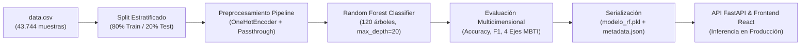
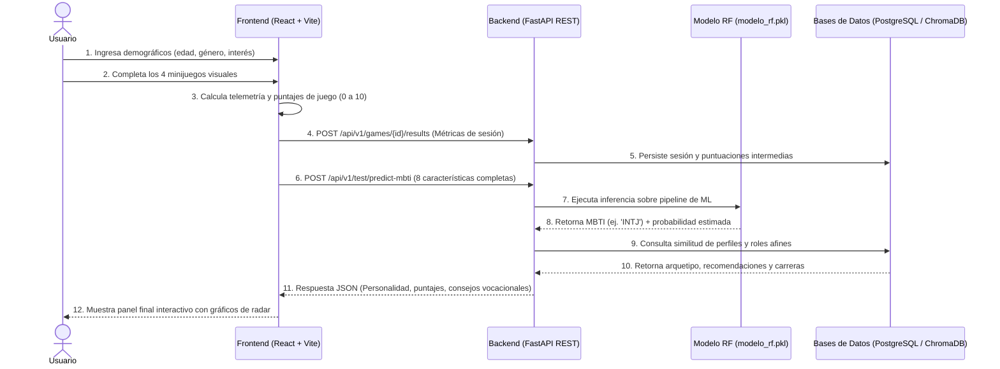

# Picto-Path AI — Sistema Inteligente de Orientación Vocacional Basado en Estímulos Visuales y Clasificación MBTI

> **Curso:** Inteligencia Artificial 
> **Institución:** Universidad EAFIT  
> **Autores:**  
> - Andrés Eusse 
> - Isabella Ocampo 
> - María Laura Tafur  
> - Juan Hernández Martelo 

---

## 1. Introducción

**Picto-Path AI** es un sistema inteligente de orientación vocacional que reemplaza los cuestionarios de texto tradicionales por un test interactivo de estímulos visuales. Analiza las elecciones visuales del usuario para clasificar rasgos de personalidad, mapearlos con marcos psicológicos validados y recomendar perfiles profesionales afines mediante grafos de conocimiento y similitud vectorial.

**Picto-Path AI** (pq es relevante y que aporta)

---

## 2. Objetivos

### Objetivo General
Desarrollar un sistema interactivo e inteligente de orientación vocacional que prediga el perfil de personalidad MBTI a partir de la interacción conductual en minijuegos visuales mediante un modelo de clasificación supervisado.

### Objetivos Específicos
1. **Diseñar y calibrar cuatro minijuegos interactivos** capaces de cuantificar objetivamente las cuatro dimensiones dicotómicas del modelo MBTI ($E/I$, $S/N$, $T/F$, $J/P$) en escalas normalizadas de $0.0$ a $10.0$ puntos.

2. **Entrenar y validar un pipeline de clasificación supervisada** con Random Forest sobre un dataset psicométrico de 43,744 muestras, logrando una Accuracy y F1-score macro superiores al $88\%$ en la discriminación de las 16 clases de personalidad.

3. **Implementar un módulo de recomendación vocacional** que mapee el perfil de personalidad predicho con trayectorias profesionales, competencias clave y estrategias de desarrollo personal fundamentadas en marcos ocupacionales y similitud de perfiles.

---

## 3. Descripción de los Datos

* **Fuente y obtención:** Dataset psicométrico estructurado (*Predict People Personality Types* de Kaggle), almacenado localmente en [`data.csv`](file:///d:/Documents/U/semestre5/ia/proyecto/data.csv).

* **Tamaño y formato:** 43,744 observaciones estructuradas en formato tabular CSV, sin valores faltantes (43,744 filas $\times$ 9 columnas).

### Tabla Resumen de Variables

| Variable | Tipo de Dato | Rango / Valores | Descripción / Rol en el Modelo |
| :--- | :--- | :--- | :--- |
| `Age` | Numérica (int) | $18$ a $52$ años | Edad cronológica del participante |
| `Gender` | Categórica (str) | `Female`, `Male` | Género reportado por el usuario |
| `Education` | Numérica (int) | $0$ (Pregrado/Menor), $1$ (Posgrado) | Nivel académico alcanzado |
| `Interest` | Categórica (str) | `Technology`, `Arts`, `Sports`, `Others`, `Unknown` | Área vocacional o interés primario |
| `Introversion Score` | Numérica (float) | $0.0$ a $10.0$ | Puntaje extraído del juego de interacción social ($E/I$) |
| `Sensing Score` | Numérica (float) | $0.0$ a $10.0$ | Puntaje extraído del juego de agilidad visual ($S/N$) |
| `Thinking Score` | Numérica (float) | $0.0$ a $10.0$ | Puntaje extraído del juego de toma de decisiones ($T/F$) |
| `Judging Score` | Numérica (float) | $0.0$ a $10.0$ | Puntaje extraído del juego de laberinto y orden ($J/P$) |
| **`Personality`** *(Target)* | Categórica (str) | 16 tipos MBTI (`ENFJ`, `INTJ`, `ISTP`, etc.) | Etiqueta supervisada de personalidad |

* **Preprocesamiento:** Pipeline automatizado mediante `ColumnTransformer` que aplica codificación One-Hot (`OneHotEncoder(handle_unknown='ignore')`) sobre variables categóricas (`Gender`, `Interest`) y conserva las numéricas en paso directo (`passthrough`).

* **Limitaciones y Licencia:** Datos provenientes de simulaciones psicométricas balanceadas con representatividad equilibrada entre las 16 clases; no incorpora aún comorbilidades psicológicas complejas. Uso estrictamente académico y pedagógico bajo licencia de datos abiertos (ODC-By / CC BY 4.0).

---

## 4. Metodología

La solución se diseñó siguiendo un ciclo iterativo de Machine Learning estructurado en 5 etapas:

1. **Ingeniería de Características y Extracción Psicométrica:** Cada minijuego traduce la conducta motriz y visual en una fórmula matemática normalizada.

2. **Partición de Datos Estratificada:** División 80/20 (34,995 muestras de entrenamiento y 8,749 de prueba) garantizando idéntica proporción de las 16 clases en ambos subconjuntos (`stratify=y`).

3. **Selección del Modelo y Justificación de Hiperparámetros:**
   - **Algoritmo:** `RandomForestClassifier` (120 estimadores, profundidad máxima 20, semilla fija 42).
   - **Justificación:** Se seleccionó un ensamble de árboles aleatorios (Random Forest) debido a su robustez frente al sobreajuste, su invariancia de escala en las entradas continuas y su excelente capacidad para capturar interacciones no lineales entre las cuatro dimensiones psicométricas sin requerir normalizaciones gaussianas forzadas.
4. **Validación y Métricas:** Medición de Accuracy Global, F1-Score Macro (para castigar caídas en clases minoritarias), F1 Ponderado y precisión segmentada por cada uno de los 4 ejes MBTI.
5. **Serialización y Despliegue:** Exportación reproducible a artefacto binario [`ai_model/models/modelo_rf.pkl`](file:///d:/Documents/U/semestre5/ia/proyecto/ai_model/models/modelo_rf.pkl) acompañado de metadatos trazables en [`model_metadata.json`](file:///d:/Documents/U/semestre5/ia/proyecto/ai_model/models/model_metadata.json).

### Diagrama de Flujo 



---

## 5. Diagrama UML

En el entorno productivo contenerizado, el usuario realiza la prueba visualmente desde la interfaz React; los resultados son transmitidos asíncronamente al backend FastAPI, que consulta el modelo en memoria y recupera la orientación vocacional personalizada:



---

## 6. Resultados

### Rendimiento Global del Modelo

El modelo fue evaluado en el conjunto de prueba independiente (8,749 muestras nunca vistas durante el entrenamiento) y comparado contra líneas base teóricas y empíricas:

| Modelo / Enfoque | Exactitud Global (Accuracy) | F1-Score Macro | F1-Score Ponderado | Latencia de Inferencia |
| :--- | :---: | :---: | :---: | :---: |
| **Clasificador Aleatorio (Línea Base Uniforme)** | $6.25\%$ ($1/16$) | $0.0625$ | $0.0625$ | $< 0.1\text{ ms}$ |
| **Árbol de Decisión Simple (Baseline)** | $73.40\%$ | $0.7335$ | $0.7338$ | $0.8\text{ ms}$ |
| **Random Forest (Picto-Path AI — Final)** | **$90.17\%$** | **$0.9017$** | **$0.9017$** | **$1.8\text{ ms}$** |

### Desglose de Precisión por Eje Psicométrico MBTI

| Eje Dicotómico | Dimensión Psicológica | Minijuego Asociado | Precisión Alcanzada |
| :---: | :--- | :--- | :---: |
| **E / I** | Energía: Extroversión vs. Introversión | Interacción Social de Cafetería | **$93.03\%$** |
| **S / N** | Percepción: Sensorial vs. Intuición | Encuentra las 5 Diferencias | **$97.02\%$** |
| **T / F** | Juicio: Pensamiento vs. Sentimiento | Balanza de Dilemas Morales | **$99.93\%$** |
| **J / P** | Estilo de Vida: Juicio vs. Percepción | Laberinto y Planificación Espacial | **$99.93\%$** |

### Análisis de Resultados y Limitaciones
* **Aciertos:** Los ejes $T/F$ y $J/P$ alcanzaron una separabilidad casi perfecta ($>99.9\%$), lo que demuestra que las métricas de toma de decisiones bajo presión y adherencia a planes son altamente discriminatorias. El eje de percepción $S/N$ alcanzó un sobresaliente $97.02\%$ gracias a la calibración entre aciertos y tiempos de latencia visual.
* **Aspectos a mejorar / Limitaciones:** El eje $E/I$ registró la mayor tasa de confusión relativa ($93.03\%$), concentrada en usuarios con puntajes intermedios (rango $4.8$ a $5.2$). La inferencia actual asume condiciones óptimas de hardware; variaciones extremas en los FPS del navegador podrían agregar una pequeña varianza en los tiempos de respuesta.

---

## 7. Reproducibilidad

### Requisitos del Sistema
- **Docker Desktop** (versión 24.0+ recomendada) y **Docker Compose**.
- *Alternativa local:* Python 3.12+ y Node.js 18+.

### Ejecución Rápida (Comandos Mínimos)

1. **Clonar el repositorio y situarse en la raíz:**
   ```bash
   git clone https://github.com/Eusse7/picto-path-ai.git
   cd picto-path-ai
   ```

2. **Entrenar y exportar el modelo de Machine Learning (Paso de ML):**
   ```bash
   python ai_model/scripts/train.py --data-path data.csv --output-dir ai_model/models
   ```
   *(Genera `ai_model/models/modelo_rf.pkl` y `model_metadata.json`).*

3. **Configurar variables e iniciar los servicios con Docker:**
   ```bash
   cp .env.example .env
   docker compose up --build -d
   ```

4. **Lanzar la interfaz de usuario (Frontend):**
   ```bash
   cd frontend
   npm install
   npm run dev
   ```

### Enlaces de Acceso Local
* **Aplicación Web / Test Interactivo:** [http://localhost:5173](http://localhost:5173)
* **Documentación Interactiva de la API (Swagger UI):** [http://localhost:8000/docs](http://localhost:8000/docs)
* **Servicio ChromaDB:** [http://localhost:8001](http://localhost:8001)
* **Base de Datos PostgreSQL:** `localhost:5433` (`picto_path_db`)

---

## 8. Estructura del Repositorio

```text
picto-path-ai/
├── ai_model/                 # Módulo de Inteligencia Artificial
│   ├── models/               # Binarios entrenados (modelo_rf.pkl, metadata.json)
│   ├── notebooks/            # Cuadernos de experimentación y EDA
│   └── scripts/              # Scripts de entrenamiento y evaluación (train.py, evaluate.py)
├── backend/                  # API REST construida con FastAPI
│   ├── app/
│   │   ├── api/endpoints/    # Rutas para juegos, test vocacional y salud (/predict-mbti)
│   │   ├── core/             # Configuración del sistema y variables de entorno
│   │   ├── db/               # Conectores a PostgreSQL y ChromaDB
│   │   └── services/         # Inferencia de ML, sesiones y recomendaciones RAG
│   └── Dockerfile            # Imagen contenerizada del backend
├── frontend/                 # Interfaz de usuario React + Vite
│   ├── src/
│   │   ├── components/       # Minijuegos: SensingGame, IntroversionGame, JudgingGame, ThinkingGame
│   │   ├── App.jsx           # Hub principal y orquestador del test vocacional
│   │   └── main.jsx          # Punto de entrada de React
│   └── Dockerfile            # Imagen contenerizada del frontend
├── games/                    # Lógica modular e independiente de cada minijuego
│   ├── introversion_game/    # Juego de cafetería e interacción social
│   ├── judging_game/         # Juego de laberinto y estrategia
│   ├── sensing_game/         # Juego de agilidad visual "Encuentra las diferencias"
│   └── thinking_game/        # Juego de balanza y dilemas morales
├── data.csv                  # Dataset psicométrico de 43,744 muestras
├── docker-compose.yml        # Orquestación de Backend, PostgreSQL y ChromaDB
├── .env.example              # Plantilla de variables de entorno
└── README.md                 # Documentación técnica y académica de entrega final
```
